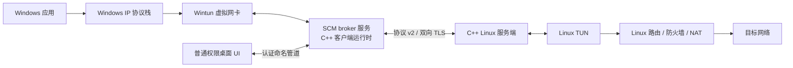

# Personal-VPN

[](https://github.com/Dahyunnist/Personal-VPN/actions/workflows/ci.yml)

Personal-VPN 是一个基于 C++17 的双栈 VPN 隧道参考实现：Windows 客户端通过 Wintun 接入本机 IPv4/IPv6 网络，使用协议 v2 和双向 TLS 与 Linux 服务端通信；服务端将经过认证和校验的数据包转发到 Linux TUN 设备。

本项目用于学习、技术预研和工程实践，不是可直接部署的商用 VPN 产品。项目尚未经过独立安全审计，不应承载生产或敏感流量。

## 项目架构



客户端从 Wintun 读取 IPv4/IPv6 数据包，校验源地址后封装并通过 TLS 发送。服务端验证客户端证书，将身份绑定到服务端分配的双栈地址租约，再校验数据包并写入 TUN。回程数据包按目标租约路由，只能交付给拥有该地址的会话。

## 当前能力

- **双栈协议 v2：** 采用带版本的 20 字节帧头，承载 IPv4/IPv6 数据包；限制长度、标志位、消息顺序和序列号，并处理 TLS 读操作中的拆包与粘包。
- **身份认证与地址授权：** 双向 TLS、主机名验证、可选客户端 CRL、证书指纹身份，以及服务端管理的 IPv4/IPv6 地址租约和按租约路由。
- **证书吊销：** 服务端可拒绝 CRL 中的客户端证书；客户端 schema v2 必须配置 PEM CRL，并拒绝已撤销的服务器叶证书。schema v1 保持兼容，不执行服务器 CRL 检查。
- **异步并发控制：** 串行化 TLS 流操作；管理自有缓冲区和有界写队列；提供背压、超时、TUN 读操作约束及幂等关闭。
- **Windows 双栈网络事务：** 配置 Wintun、IPv4/IPv6 地址、双栈 MTU 和路由；失败时按反序回滚，不删除操作前已存在的主机网络状态。
- **凭据保护：** Linux 服务端检查私钥文件权限；Windows 客户端预检私钥 ACL，并限制凭据文件加载方式。
- **运行与发布基础：** Linux 服务端配置和 systemd 示例、JSON 指标、CI、ASan/UBSan、协议模糊测试、基准测试、CPack 打包及发布校验流程。
- **Windows 权限边界探索：** SCM broker、管理员安装脚本、受保护 profile 导入器和客户端运行时适配器已接入桌面 UI。普通 UI 通过受 ACL 保护的命名管道请求服务连接，不直接创建 Wintun 或配置路由；断线、注销或服务停止时由服务清理运行时。profile 与凭据副本保存在当前用户受保护目录；UI 可删除当前选中的 profile 副本，尚无历史列表和批量管理。当前仅支持活动物理控制台会话；RDP、多用户并发、安装升级回滚、服务 ACL 与真实 Wintun 部署验证仍未完成。部署步骤见 [Windows broker 服务指南](docs/deployment/windows-broker.md)。

## 验证状态

以下为本地阶段性验证结果，不代表独立安全审计或生产环境验证：

| 验证项 | 最近结果 | 说明 |
| --- | --- | --- |
| Linux 构建与测试 | 20/20 通过 | Ubuntu WSL；含 IPv4/IPv6 双向 TLS 隧道集成测试及服务器、客户端 CRL 握手测试，测试证书存放在 Linux 文件系统 |
| Windows 构建与测试 | 13/13 通过 | MinGW 桌面客户端完整测试集；含 schema v2 profile 导入、CRL 复制与删除，以及 IPv4/IPv6 WFP 故障关闭策略构建与输入边界测试 |
| Windows 核心构建与测试 | MinGW 9/9；MSVC Debug/Release 通过 | 最新远程 CI 的核心配置通过 |
| Windows broker 安装器集成 | 通过 | 最新远程 Windows CI 验证安装器生命周期；受保护祖先目录允许标准卷上的“创建子目录”权限，带 `DeleteSubdirectoriesAndFiles` 权限的祖先仍被拒绝 |
| Windows ZIP 内容 | 本地校验未通过 | 包含客户端、broker 和安装脚本，但本机已有的 Wintun DLL 缺少随包许可证文件；该 ZIP 不可分发 |
| 远程 CI（`0c44a0c`） | CI 全部任务通过；CodeQL 通过 | Linux Debug/Release、Windows 核心 Debug/Release、Windows 桌面构建与测试、broker 安装器生命周期、ZIP 校验、仓库策略、ASan/UBSan、协议 fuzz、benchmark 和 CodeQL 均通过 |
| 性能与健壮性工具 | 已配置 | CI 含 sanitizer、协议 fuzz 和 benchmark 工作流；具体结果以对应工作流记录及项目文档为准 |

以上测试验证代码构建和自动化测试，不代表真实公网 IPv6 连通性、双主机部署或生产环境验证。Linux 服务端不会自动开启 IPv6 转发、配置云防火墙、上游路由或 NAT66；部署前请阅读 [IPv6 部署说明](docs/operations/ipv6-deployment.md)。

协议微基准曾在 Windows 10 x64、GCC 14.2.0、1400 字节载荷下测得：编码 3,761.38 MiB/s、解码 4,471.05 MiB/s。该数字只表示协议编解码微基准，不代表端到端 VPN 吞吐量。受控的带宽、延迟、CPU、并发和长稳测试方法见[性能测试说明](docs/performance/benchmarking.md)。

## Linux 服务端：构建与测试

依赖：CMake 3.21 或更高版本、支持 C++17 的编译器、Boost、OpenSSL 和 Ninja。

```bash
cmake -S . -B out/release -G Ninja \
  -DCMAKE_BUILD_TYPE=Release \
  -DPERSONAL_VPN_WARNINGS_AS_ERRORS=ON
cmake --build out/release --parallel
ctest --test-dir out/release --output-on-failure
out/release/personal-vpn-server --help
```

服务端不会自动修改主机的转发、防火墙或 NAT 规则。部署前请阅读 [Linux 部署指南](docs/deployment/linux-server.md)，并自行配置 TUN、路由、NAT、专用服务账号和 PKI。

### 在 WSL 中测试

如果源码位于 `/mnt/<盘符>`，该路径通常使用 DrvFS；默认情况下，`chmod` 权限可能无法按 Linux 文件系统方式保存。本项目会在 WSL 下把测试 PKI 放在 `/tmp`，避免测试私钥被误判为权限过宽。不要因此放宽生产私钥的权限校验。

## Windows 客户端：构建与测试

使用 x64 Visual Studio 环境，并通过 CMake 工具链提供 Boost 和 OpenSSL。Release/CI 构建可下载固定版本的 Wintun 0.14.1，并在打包前校验 SHA-256。

```powershell
cmake -S . -B out/windows-client -A x64 `
  -DCMAKE_TOOLCHAIN_FILE="$env:VCPKG_ROOT/scripts/buildsystems/vcpkg.cmake" `
  -DVCPKG_TARGET_TRIPLET=x64-windows-static `
  -DPERSONAL_VPN_BUILD_LINUX_TRANSPORT=OFF `
  -DPERSONAL_VPN_BUILD_CLIENT_TRANSPORT=ON `
  -DPERSONAL_VPN_BUILD_WINDOWS_UI=ON `
  -DPERSONAL_VPN_FETCH_WINTUN=ON
cmake --build out/windows-client --config Release --parallel
ctest --test-dir out/windows-client -C Release --output-on-failure
```

客户端 UI 正常启动不需要提升权限。连接前，管理员需按[Windows broker 服务指南](docs/deployment/windows-broker.md)安装服务并配置机器网络策略；用户再以 [`configs/client-v2.example.json`](configs/client-v2.example.json) 为基础填写凭据路径和服务器 CRL。导入会把配置和凭据复制到当前用户受保护的 profile 目录。配置文件引用外部证书文件，不在配置中内嵌私钥。关闭持续性断线保护时会单独触发 UAC 提权确认。

## 文档索引

- [系统架构与数据包流向](docs/architecture/overview.md)
- [线路协议 v2](docs/protocol-v2.md)
- [IPv6 部署说明](docs/operations/ipv6-deployment.md)
- [威胁模型](docs/security/threat-model.md)
- [凭据处理与证书吊销](docs/security/credential-handling.md)
- [观测指标与资源限制](docs/architecture/observability-and-limits.md)
- [Linux 部署指南](docs/deployment/linux-server.md)
- [发布工程与供应链](docs/deployment/release-engineering.md)
- [运维手册与故障排查](docs/operations/runbook.md)
- [尚待执行的验证步骤](docs/operations/deferred-verification-sop.md)
- [项目复盘与面试讲解](docs/portfolio/project-case-study.md)
- [申请与招聘材料草稿](docs/portfolio/application-materials.md)
- [已知限制与后续路线图](docs/roadmap.md)
- [知识产权与许可确认清单](docs/governance/ip-and-licensing-checklist.md)

## 代码目录

```text
src/protocol/      线路帧编解码与控制消息
src/core/          跨平台状态、路由、地址租约和队列
src/server/        Linux TUN 与异步双向 TLS 服务端
src/client/        可复用客户端运行时与 Windows 网络后端
src/broker/        Windows 特权 broker 请求协议
vpn_client_ui/     Win32、DirectX 11 与 Dear ImGui 桌面客户端
tests/             单元、集成、超时、TLS 与端到端测试
fuzz/              libFuzzer 目标与协议字典
benchmarks/        协议微基准
deploy/            systemd 等部署示例
docs/              架构、安全、运维、验证和项目材料
vpn_base/          保留的实习原型，用于历史对照
```

## 已知限制

- v2 支持 IPv4/IPv6 隧道数据面；当前 IPv6 地址池要求 `/64`，且不实现 SLAAC、DHCPv6、邻居发现代理或 NAT66。公网 IPv6 可达性依赖服务器转发、上游路由及防火墙配置。
- 数据传输采用 TLS/TCP；网络丢包时可能出现 TCP-over-TCP 性能退化。
- 客户端支持带抖动的指数退避重连；不支持会话恢复、漫游或无缝网络切换。
- 服务端可通过 `SIGHUP` 验证并切换 TLS 凭据；客户端凭据变更仍需重启客户端，已有会话继续使用原 TLS 上下文。
- 指标输出到标准输出；没有原生 Prometheus 网络端点或分布式追踪。
- Linux 转发/路由配置、Windows broker 安装和机器策略仍需要管理员参与；broker 尚未通过真实服务身份、ACL、升级回滚和 Wintun 隧道验证。WFP 故障关闭规则有策略单测，但尚未在真实 Windows 主机上验证实际网络过滤行为。
- Windows GUI 可删除当前选中的导入 profile 及本地凭据副本；暂不提供历史 profile 列表和批量管理。
- 最新远程 CI（提交 `0c44a0c`）全部通过，CodeQL 也通过。Windows 安装器对祖先目录仅豁免“创建子目录”权限；删除子项、写入文件、ACL、所有权及重解析点检查仍保留。CI 的安装器生命周期用例验证了受保护路径接受和危险祖先 ACL 拒绝。
- 尚无签名的正式 Windows 安装包、可复现构建声明、受控端到端性能/长稳结果或独立安全审计。
- GitHub 发布工作流已配置无密钥证明等门禁；远程发布和消费者侧完整验证仍有待完成。

原型目录 `vpn_base/` 保留实习阶段实现，根目录构建系统使用重构后的实现。旧版本仓库中曾出现的凭据应视为已泄露，不应继续使用。项目的开源许可和实习成果发布权仍待确认；详情见[知识产权与许可确认清单](docs/governance/ip-and-licensing-checklist.md)。
