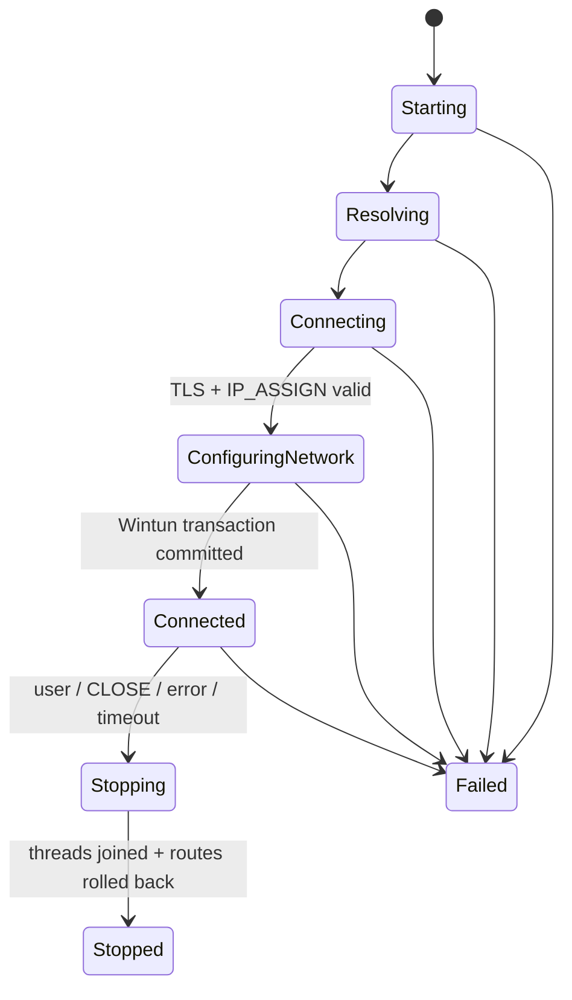

# Personal-VPN

[](https://github.com/Dahyunnist/Personal-VPN/actions/workflows/ci.yml)

Personal-VPN is a C++17 reference implementation of a mutually authenticated IP
tunnel between a Windows Wintun client and a Linux TUN server. The project focuses on
the hard engineering boundaries behind a VPN—packet ownership, framed asynchronous
I/O, identity-bound address leases, transactional route changes, bounded resources,
and deterministic shutdown—rather than presenting a production VPN service.

> **Scope:** educational/technical-pre-research project. It has not received an
> independent security audit and must not be used to protect production traffic.

## Architecture


Outbound packets enter Wintun because of explicit Windows routes. The client validates
their source address, frames them, and sends them through one serialized TLS writer.
The server authenticates the certificate, binds it to a server-assigned lease,
validates the IPv4 packet, and writes it to TUN. Return packets follow the reverse path
and may reach only the session owning the destination lease.

## Engineering highlights

- **Correct stream protocol:** a versioned, bounded 20-byte frame header handles split
  and coalesced TLS reads; invalid versions, flags, lengths, order, and sequence gaps
  fail closed.
- **Identity and authorization:** mutual TLS, strict hostname verification, optional
  client CRL, certificate-fingerprint identity, and server-authoritative generation-
  isolated IPv4 leases.
- **Asynchronous correctness:** strand-serialized TLS operations, owned buffers,
  bounded write queues, backpressure, single-operation TUN reads, deadlines, and
  idempotent shutdown.
- **Transactional Windows networking:** Wintun adapter, address, MTU, and routes are
  applied as one transaction and rolled back in exact reverse order without deleting
  pre-existing host state.
- **Operational safety:** admission limits, handshake/idle timeouts, JSON metrics,
  Linux private-key permissions, Windows key ACL preflight, hardened systemd example,
  and no shell-command construction in the client.
- **Release discipline:** Linux and Windows builds, tests, ASan/UBSan, libFuzzer smoke
  testing, a deterministic codec benchmark, pinned Wintun verification, CPack archives,
  checksums, and tag/version validation.

## Lifecycle and concurrency



The client owns one I/O thread and one interruptible Wintun reader; it never detaches a
thread. Server sessions share an `io_context` pool but serialize their own TLS stream
and queue. No callback retains borrowed packet memory.

## Verification evidence

| Gate | Current local evidence | Automated workflow |
|---|---|---|
| Cross-platform core tests | 8/8 passed on Windows | MSVC Debug + Release |
| Linux unit/integration/E2E | 18/18 passed | GCC Debug + Release |
| Memory/undefined behavior | 18/18 passed with Clang ASan/UBSan | Dedicated sanitizer job |
| Parser robustness | libFuzzer smoke run, no finding | 20-second decoder fuzz job |
| Windows application | MinGW strict build and CPack ZIP verified | MSVC x64 package job |
| Protocol codec | 200,000 frames; 3,122.72 MiB/s encode, 4,416.04 MiB/s decode | Release benchmark job |

The local Linux/sanitizer/fuzz evidence was collected before the final release-document
edits; the clean final rerun and remote workflows are deferred while this workstation
cannot authorize WSL/GitHub operations. Follow the
[deferred verification SOP](docs/operations/deferred-verification-sop.md) before tagging.

The codec number was measured on Windows x64 with GCC 14.2.0 and a 1,400-byte payload.
It is **not** end-to-end VPN throughput. The controlled iperf3/RTT/CPU/concurrency/soak
methodology is documented in [performance benchmarking](docs/performance/benchmarking.md);
no unmeasured production-like number is claimed.

## Build and test the Linux server

Dependencies: CMake 3.21+, a C++17 compiler, Boost headers, OpenSSL, and Ninja.

```bash
cmake -S . -B out/release -G Ninja \
  -DCMAKE_BUILD_TYPE=Release \
  -DPERSONAL_VPN_WARNINGS_AS_ERRORS=ON
cmake --build out/release --parallel
ctest --test-dir out/release --output-on-failure
out/release/personal-vpn-server --help
```

The server does not edit host firewall or forwarding policy. Follow the
[Linux deployment guide](docs/deployment/linux-server.md) to provision TUN, routing,
NAT, a dedicated service account, and PKI explicitly.

## Build the Windows client

Use an x64 Visual Studio environment with Boost and OpenSSL available through a CMake
toolchain. Release/CI builds can fetch the pinned Wintun 0.14.1 archive and verify its
SHA-256 before packaging.

```powershell
cmake -S . -B out/windows-client -A x64 `
  -DCMAKE_TOOLCHAIN_FILE="$env:VCPKG_ROOT/scripts/buildsystems/vcpkg.cmake" `
  -DVCPKG_TARGET_TRIPLET=x64-windows-static `
  -DPERSONAL_VPN_BUILD_LINUX_TRANSPORT=OFF `
  -DPERSONAL_VPN_BUILD_CLIENT_TRANSPORT=ON `
  -DPERSONAL_VPN_BUILD_WINDOWS_UI=ON `
  -DPERSONAL_VPN_FETCH_WINTUN=ON
cmake --build out/windows-client --config Release --parallel
ctest --test-dir out/windows-client -C Release --output-on-failure
```

Run the client elevated and import a copy of
[`configs/client.example.json`](configs/client.example.json) that references external
certificate files. The profile never contains private-key material inline.

## Documentation map

- [System architecture and packet flow](docs/architecture/overview.md)
- [Wire protocol v1](docs/protocol-v1.md)
- [Threat model](docs/security/threat-model.md)
- [Credential handling and revocation](docs/security/credential-handling.md)
- [Observability and limits](docs/architecture/observability-and-limits.md)
- [Release engineering](docs/deployment/release-engineering.md)
- [Operations and troubleshooting](docs/operations/runbook.md)
- [Deferred final verification SOP](docs/operations/deferred-verification-sop.md)
- [Project case study and interview guide](docs/portfolio/project-case-study.md)
- [Application and recruiting drafts](docs/portfolio/application-materials.md)
- [Known limitations and roadmap](docs/roadmap.md)

## Repository layout

```text
src/protocol/      wire framing and control messages
src/core/          platform-neutral state, routing, leases, queues
src/server/        Linux TUN and asynchronous mTLS server
src/client/        portable client runtime and Windows network backend
vpn_client_ui/     Win32 / DirectX 11 / Dear ImGui desktop application
tests/             unit, integration, timeout, TLS, and end-to-end tests
fuzz/              libFuzzer target and protocol dictionary
benchmarks/        deterministic protocol microbenchmark
deploy/            hardened service examples
docs/              architecture, security, operations, evidence
vpn_base/          preserved internship prototype for historical comparison
```

## Historical context and limitations

`vpn_base/` preserves the original internship prototype; the root build uses the
redesigned implementation. Earlier repository credentials must be treated as
compromised even if removed from the current tree.

The project currently supports IPv4 over TLS/TCP, uses one Linux TUN, has no automatic
reconnect or live certificate rotation, and has not yet published controlled
end-to-end performance/soak results. See the [roadmap](docs/roadmap.md).

Because this work originated during an internship, no open-source license is asserted
until ownership and publication rights are confirmed. See the
[IP and licensing checklist](docs/governance/ip-and-licensing-checklist.md).
